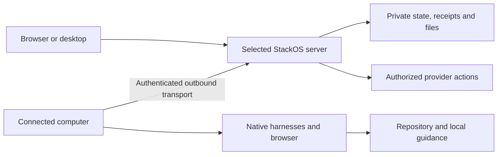

# Server and connected-computer responsibilities

Source baseline: `74d140a8c82f7effd2063bbaa886741980720d4a`, consolidating
workflow 796 with current main. The reviewed work is retained on the separate
`codex/server-consolidated-796` branch; it is not present in main's current tree.
This is the current capability map and proposed
placement for an explicitly selected server installation. It does not claim
hosted deployment or complete feature parity. Update it with affected deliveries.

The [product contract](product-direction.md#product-contract) remains canonical:
standalone use stays available, agents make operating decisions, and operations,
repositories and plugin owners remain shared. Provider credentials may move to
server custody only through an explicit managed-custody choice. Native harness
login credentials and repository access stay on the connected computer.

## Allocation

| Responsibility | Proposed location | Existing owner |
| --- | --- | --- |
| Projects, private ownership, templates, extensions, resources, runs, tickets, receipts and audit | Server, for projects deliberately created or moved there | Existing repositories, operation registry and grant checks |
| Delivery sequencing, independent review, schedule admission and request state | Server | `task_delivery`, `WorkflowScheduleRuntime`, run-plan and request repositories |
| Native agent launch/resume/stop, harness accounts, subscriptions, model discovery, Git and adapted guidance files | Connected computer | `host_mcp`, project-agent/file owners and local runtime transport |
| Provider HTTP actions and private generated files | Server when the Account is explicitly placed in server custody | Auth repository, action executor, connectors and managed file owner |
| Browser process, persistent profile, local-only tools and repository files | Connected computer | Existing browser and native execution owners |
| Screens, approvals, status and recovery controls | Browser or desktop rendering the selected environment | Same operations and state; native desktop integrations remain local |

The transport moves explicit invocations, observations and results. It does not
create another scheduler, reviewer, project database or business controller.
An offline computer prevents work that needs that computer; it need not prevent
browsing server state or independently authorized server actions.

## Current feature coverage

“Supported” means source implementation with relevant automated proof, not a
signed-off installed or publicly hosted product. Denied operations need their
actual owner and consumer adapted; widening an allowlist is insufficient.

| Area | Current behavior and remaining gap | Source owners |
| --- | --- | --- |
| Sign-in and private projects | Browser, desktop and native-client authentication, ownership and revocation are implemented. Project creation/list/read are supported; visible rename/delete controls still call denied `project.update/delete`. Adapt owner-aware updates and cleanup, including active connected work and retained files/history. Projects start fresh; signup does not adopt local projects. Hosted identity/origin configuration and installed onboarding remain unverified. | [Auth](../stackos/auth.py), [auth routes](../stackos/api/auth.py), [project access](../stackos/repositories/project_access.py), [project UI](../ui/src/stores/projects.ts), [setup](setup.md#browser-and-desktop-server-sign-in) |
| Database and durable state | Private PostgreSQL schema, migrations, typed JSON readers and current statistics queries are integrated. Runtime processes have no application database. Standalone SQLite remains separate. | [Database](../stackos/db/connection.py), [merge migration](../stackos/db/migrations/versions/0054_online_current_merge.py), [JSON expressions](../stackos/db/json_expressions.py) |
| Overview and Project Home | Owned project summaries and project statistics are implemented. Server Overview hides global charts and machine diagnostics. Current screens still request denied `tracker.activeTasks*`, delivery-capacity and `projectSetup.get` operations. Cards, reads and permissions need coherent server behavior. | [Home](../ui/src/views/HomeView.vue), [Project Home](../ui/src/views/HomeConsoleView.vue), [active tasks](../ui/src/composables/useActiveTasks.ts), [operation admission](../stackos/repositories/project_access.py) |
| Work, delivery and independent review | The existing controller dispatches connected delivery/review and retains receipts, measured usage and ordinary retry history. Newer inspection/context-edit/capacity controls are not all admitted remotely. Unknown outcomes require explicit reconciliation, never automatic replay. | [Delivery](../stackos/task_delivery.py), [exchange](../stackos/local_runtime/exchange.py), [host service](../stackos/host_mcp/service.py), [tracker operations](../stackos/operations/tracker/specs.py) |
| Recovery and maintenance continuation | Connected ordinary retry is covered. Evidence-only candidate recovery, reviewer replacement and reporting-only continuation explicitly refuse unsupported connected use. Standalone recovery remains intact. Server/runtime upgrade and account-switch continuation parity require work at existing owners. | [Delivery](../stackos/task_delivery.py), [runtime lifecycle](../stackos/cli/local_commands.py), [upgrade contract](upgrade.md) |
| Project Setup/Update | Use the same tracked setup workflow on the server, with adaptation, native proof and file writes on the computer. Current `projectSetup.*` operations and launch UI are not adapted to this route. Do not introduce a background setup controller. | [Setup repository](../stackos/repositories/project_setup.py), [setup operations](../stackos/operations/project_setup.py), [setup UI](../ui/src/views/project-setup/useProjectSetup.ts) |
| Agent settings and guidance | Durable selections belong with the project; exact host files and native capabilities belong with its computer. `tracker.configureDelivery` and `projectAgent.*` still depend on local administration/filesystem context. Server role selection does not complete this flow. | [Project agents](../stackos/operations/project_agents.py), [project guidance](agent-operating-model.md#canonical-project-guidance-consumption), [agent presets](agent-presets.md) |
| Multiple repositories and harnesses | One runtime state directory retains one environment/owner/project/folder binding and refuses replacement scope. Connected native execution is Codex-only. Standalone Claude, Antigravity, Grok and Hermes support does not establish connected support. Extend existing binding/dispatch owners, not one delivery system per harness. | [Connection](../stackos/local_runtime/connection.py), [native adapter](../stackos/local_runtime/native.py), [worker](../stackos/local_runtime/worker.py) |
| Harness accounts, quotas and model catalogs | Native credentials, account selection, CLI installation and process restart stay on the computer. Server Overview omits these local probes. Remote observations/controls and model selection still need explicit computer routing; do not upload harness homes or login files. | [Host layer](../stackos/host_mcp/), [Overview](../ui/src/views/HomeView.vue), [host setup](setup.md) |
| Provider Accounts and Connections | Private server Accounts and project attachments have adapted APIs. Credential custody is explicit, not migration of existing secrets. Server navigation hides Accounts, and some copy assumes a local daemon. Machine-bound auth methods need separate placement. | [Account access](../stackos/auth_providers/repository/access.py), [credentials](../stackos/auth_providers/repository/credentials.py), [auth API](../stackos/api/auth_providers.py), [auth guidance](auth-providers.md) |
| Connectors and provider actions, including ElevenLabs | The same manifests, connector package and action executor run HTTP calls with admitted Accounts and grants. Current media, Slack, Telegram and durable-file consumers enforce project file custody. Native dependencies and unavailable local input files still need their real execution target. | [Action executor](../stackos/actions/repository/execution.py), [shared files](../stackos/actions/media_artifacts.py), [ElevenLabs](../stackos/actions/elevenlabs.py), [action contract](action-executor.md) |
| Resources, artifacts, context, learnings and decisions | Admitted operations store private project truth on the server; host adaptations remain local materializations of approved guidance. Catalog mutation/admin operations are not all admitted; read support does not imply every edit path works. | [Operation admission](../stackos/repositories/project_access.py), [resources](../stackos/repositories/resources.py), [context](../stackos/context/repository/queries.py), [run grants](../stackos/workflows/run_plan_grants.py) |
| Plugins, workflows and presets | Shared definitions ship with the deployed package; project configuration/extensions belong with server state. Mutation/activation operations including `plugin.enable` are not adapted. Local setup must consume the same source identity without a second catalog. | [Registry](../stackos/operations/registry.py), [project admission](../stackos/repositories/project_access.py), [setup contract](workflow-templates.md#agent-workflow-setup-lifecycle) |
| Finance | Proposed server placement covers private records, originals, reports and request state; native analysis executes locally. Finance currently uses managed local files and trusted-local-admin routes. `finance.status/query/report.render`, plugin activation and request/chat operations are not server-ready although Finance navigation is visible. Preserve the plugin/file owner. | [Finance operations](../stackos/operations/finance.py), [managed files](../stackos/plugins/builtin_finance.py), [Finance contract](../plugins/finance/references/local-workspace-contract.md) |
| Schedules | Server timing/request admission reuse the project-main request flow; a selected computer supplies native execution/presence. The editor preserves an existing `connection_id` but cannot select a new computer. No catch-up replay or second scheduler is implied. | [Schedule runtime](../stackos/jobs/workflow_schedules.py), [editor](../ui/src/views/project-detail/ScheduleEditor.vue), [availability](architecture.md#native-desktop-schedule-admission) |
| Communications and public ingress | Provider-neutral state, webhook verification and authorized sends should live with the server. `communication.*` is not owner-adapted; server auth does not inherit legacy public webhook exemptions. Native Telegram auth is refused for server-owned Accounts, and daemon startup needs explicit placement. HTTP file tests do not prove a functioning server Telegram account. | [Communications contract](integration-contracts/communications.md), [credentials](../stackos/auth_providers/repository/credentials.py), [startup](../stackos/server.py), [auth middleware](../stackos/auth.py) |
| Notifications | Task facts belong with the server; presentation belongs with clients. Server desktop mode skips the local notification controller/IPC. Adapt the existing cursor/deduplication owner rather than adding another queue. | [Desktop main](../desktop/src/main.js), [notifications](../desktop/src/notifications.js), [tracker changes](../stackos/repositories/tracker/notification_changes.py) |
| Patterns | Bundled recommendations are shared package content. Customizations/deletions currently belong to the installation; choose server ownership before admitting `pattern.*`. Recommended direction: private user customizations over bundled guidance, retaining explicit project application. This is proposed, not implemented scope. | [Product contract](product-direction.md#product-layers), [operation admission](../stackos/repositories/project_access.py), [registry](../stackos/operations/registry.py) |
| Browser automation | Connected execution keeps the real browser/profile on its computer; server operations retain project authorization and metadata. The server itself does not launch a desktop browser. | [Runtime browser](../stackos/local_runtime/browser.py), [browser repository](../stackos/repositories/browser.py), [browser contract](browser-automation.md) |
| Files and transfers | Managed private server files and authorized, checksummed downloads to explicit local destinations are implemented. A local path is not a server file. Generic local-input upload is missing; downloads alone cannot complete Finance receipt intake or arbitrary local-file actions. Start with existing managed storage. | [File boundary](../stackos/artifacts/files.py), [operations](../stackos/operations/files.py), [MCP downloads](../stackos/mcp/bridge/downloads.py), [artifacts](resources-and-artifacts.md) |
| Backups, restore and cutover | Existing backups are standalone-only. Server custody needs coordinated database, encryption-seed and managed-file backup/restore. Startup still schedules the standalone backup runner, which rejects this role; correct that bounded registration gap. No historical import or automatic rollback exists. | [Backup service](../stackos/backups/service.py), [startup](../stackos/server.py), [availability](backups.md#availability), [setup limits](setup.md#first-connected-flow-and-manual-attention) |
| Install, repair, upgrades and release | Runtime startup/install/repair use existing CLI, launchd and host-registration owners. Public deployment and server/runtime upgrade coordination remain separate work. Installed app handoff/lifecycle proof are still required. | [Lifecycle](../stackos/cli/local_commands.py), [desktop service](../desktop/src/service.js), [distribution](desktop-distribution.md), [release signoff](release-signoff.md) |

## What blocks a hosted deployment

Current [settings](../stackos/config.py) accept only an isolated local Supabase
environment for server/runtime roles. They require local fixture identity/ports
and loopback HTTP, and reject public HTTPS origins. Desktop URL selection
accepting HTTPS does not remove that server-side restriction.

The next work is more than putting the current binary into Docker. Continue
deployment planning in the existing workflow 798, refreshing its old assumptions
from consolidated source. This map is not an automatic handoff or a set of
oversized implementation tickets.

1. **Hosted foundation.** Add the selected hosted settings path, Compose,
   TLS/public origin, Supabase auth/database configuration, private secrets,
   durable files, health and deployment recovery. Retain standalone and isolated
   development safeguards. Establish backup/restore before depending on server
   custody; correct the invalid standalone backup registration at its owner.
2. **Project/computer execution.** Support multi-project binding and native
   harness dispatch through existing owners. Make computer selection consistent
   across delivery and schedules, retaining native settings/source identity.
   Address newer recovery/maintenance transitions with explicit capability
   presentation until supported.
3. **Current product surfaces.** Adapt actual Home/Work consumers, tracked
   Setup/Update, agent configuration, provider Account navigation and Finance.
   Select proof through each real screen/operation. Review authorization and
   state/filesystem effects before admission; mocked UI success is not server
   feature proof.
4. **Inputs and supporting services.** Add authorized local-file upload and use
   it in affected flows. Resolve communications/webhook and native Telegram
   placement, notifications and private Patterns scope. Preserve current file,
   auth, request and notification owners.
5. **Cutover and installed proof.** Decide fresh projects versus explicit import
   of selected projects, Accounts, files and history. Confirm credential custody
   and retention before copying anything. Prove restore, browser-to-app return,
   install/repair/restart and real connected delivery/review on the intended
   package/environment before claiming readiness.

These are dependent work areas for bounded planning, not new runtime layers.
Operator choices still include hosting/domain, the first hosted feature set,
credential custody, custom Patterns scope and fresh start versus data migration.
Features excluded from an initial deployment must be coherently unavailable in
its UI, not clickable controls that fail. Ordinary standalone operation is not
removed or silently converted.

## Consolidation evidence and limits

Workflow 796 delivered the local client/server foundation. Its accepted source
was merged with newer recovery, tracked setup, harness management, Finance,
scheduler and performance changes in `74d140a8`. Their standalone availability
does not establish connected parity, as the table records.

Integration passed 9,731 backend tests (20 explicit skips), 1,939 UI tests across
183 suites, the production UI build, desktop checks, Ruff and mypy. Remaining UI
signoff targets were rerun after replacing the integration worktree's dependency
link with its own locked install; the completed backend gate was retained.
Separate disposable real-PostgreSQL checks covered migrations, private auth and
Accounts, admission, typed readers and canonical revision-to-statistics behavior.

A final private-file correction passed affected media, communications and
durable-action suites, plus 26 independent boundary tests. It threads persisted
project identity through the existing resolver and removes duplicate parsers;
it adds no provider-specific permission framework. Independent review approved
source tree `02dcd4e784d8aac24089fc5e8d4190e7b7dc04f5`.

The premature main merge was reverted without rewriting history. The separate
server branch includes restored main and preserves the reviewed source; merging
it into main requires a later explicit decision.

No installed app was replaced, production database migrated or hosted service
deployed, and workflow 798 was not started. Earlier browser-to-app return proof
remains simulated until exercised on the intended installed package.
